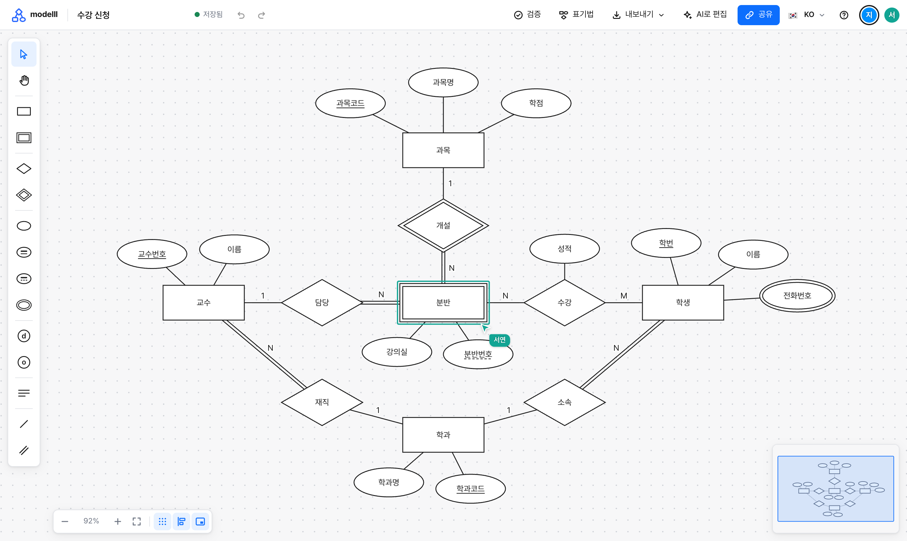

<div align="center">


# modelll

**팀과 AI가 한 캔버스에서 함께 그리는 Chen 표기법 ERD**

Collaborative Chen-notation ER diagrams that your team and your AI assistant draw together.

<br />

[**modelll.app에서 바로 시작하기**](https://modelll.app)

<br />

[](https://www.npmjs.com/package/modelll)
[](LICENSE)
[](https://github.com/heyoonyoon/modelll/stargazers)

</div>

<br />

<a href="https://modelll.app">
  
</a>

<br />

## 소개

대학 데이터베이스 수업은 Chen 표기법으로 ERD를 그리게 합니다. 그런데 널리 쓰이는 ERD 도구는 대부분 까마귀발 표기법만 지원하고, 범용 그림 도구에서는 이중 마름모나 점선 밑줄 같은 도형을 매번 손으로 만들어야 합니다. modelll은 수업에서 배운 표기 그대로 그릴 수 있고, 팀원이 각자 그린 그림을 나중에 합치는 수고 없이 처음부터 한 화면에서 같이 그리는 도구입니다.

가입은 없습니다. 방을 만들면 주소가 하나 생기고, 그 주소를 받은 사람은 이름만 정하고 들어와 같은 다이어그램을 편집합니다. 사람만 들어올 수 있는 것도 아닙니다. Claude나 ChatGPT 같은 AI가 같은 방에 엔티티와 관계를 추가하면 열어 둔 모든 화면에 바로 나타납니다.

## 주요 기능

| | |
|---|---|
| **실시간 공동 편집** | 같은 방에 있는 사람의 포인터와 선택한 도형이 이름표와 함께 보이고, 누군가 도형을 옮기면 모든 화면에서 바로 움직입니다. 한 방에는 15명까지 들어올 수 있습니다. |
| **Chen 표기법 그대로** | 약한 엔티티, 식별 관계, 다중값 속성, 복합 속성, 부분 키, 전체 참여, 특수화까지 수업에서 쓰는 도형을 팔레트에서 골라 놓습니다. |
| **표기법 검증** | 식별자가 없는 엔티티, 카디널리티가 빠진 선, 식별 관계에 연결되지 않은 약한 엔티티처럼 표기법에 어긋난 부분을 찾아 목록으로 보여 줍니다. |
| **AI와 함께 그리기** | 다이어그램을 좌표 없는 글로 읽고 쓸 수 있어서 AI가 직접 만들고 고칩니다. 새 도형은 자동으로 배치되고 사람이 옮겨 둔 도형은 제자리에 남습니다. |
| **보고서에 넣는 그림** | 완성한 다이어그램을 PNG나 SVG로 저장하거나 클립보드로 복사해 문서에 바로 붙여 넣습니다. |
| **가입 없이, 10개 언어로** | 링크 하나가 곧 방입니다. 화면은 한국어와 영어를 포함한 10개 언어로 볼 수 있습니다. |

## AI와 함께 그리기

modelll의 다이어그램은 아래처럼 글로 적을 수 있습니다. 좌표는 적지 않습니다. 위의 화면도 이런 글 한 편에서 만들어졌고, 도형의 자리는 modelll이 잡았습니다.

```text
entity 학생 {
  학번 key
  이름
  전화번호 multi
}

weak entity 분반 {
  분반번호 partial
  강의실
}

relationship 수강 (학생 M, 분반 N) { 성적 }
identifying relationship 개설 (과목 1, 분반 N total)
```

AI에게는 평소처럼 말하면 됩니다. "수강 신청 ERD를 그려 줘"라고 하면 AI가 이 글을 써서 방을 만들고 주소를 돌려줍니다. 그 방을 팀원과 함께 열어 둔 채로 "교수와 학과를 추가해 줘"라고 하면 새 도형이 눈앞에서 나타나고, 그 위에서 사람이 손으로 다듬은 배치는 다음 수정에서도 그대로 유지됩니다.

AI를 연결하는 방법은 두 가지입니다.

| | |
|---|---|
| **CLI** | Claude Code, Cursor, Codex처럼 명령을 실행할 수 있는 AI는 `npx -y modelll` 명령으로 다이어그램을 만들고 읽고 고칩니다. |
| **MCP** | claude.ai, ChatGPT, Cursor처럼 원격 MCP 서버를 지원하는 AI 도구에는 `https://modelll.app/mcp` 주소를 추가합니다. 설치할 것이 없습니다. |

방 화면의 **AI로 편집** 버튼을 누르면 그 방의 주소가 들어간 지시문과 MCP 주소를 바로 복사할 수 있습니다.

## 지원 표기법

| 요소 | 모양 |
|---|---|
| 엔티티 타입 | 직사각형 |
| 약한 엔티티 타입 | 이중 직사각형 |
| 관계 타입 | 마름모 |
| 식별 관계 타입 | 이중 마름모 |
| 속성 | 타원 |
| 다중값 속성 | 이중 타원 |
| 식별자 | 타원 안 글자에 밑줄 |
| 부분 키 | 타원 안 글자에 점선 밑줄 |
| 복합 속성 | 속성 타원에 하위 속성 타원을 선으로 연결 |
| 카디널리티 | 엔티티와 관계를 잇는 선 옆의 1, M, N |
| 전체 참여와 부분 참여 | 이중선과 단선 |
| 특수화 | 슈퍼타입과 서브타입 사이에 d 또는 o가 적힌 작은 원 |
| 재귀 관계 | 같은 엔티티와 관계를 선 두 개로 잇고 역할 이름을 표기 |

## 알아 둘 점

방의 주소를 아는 사람은 누구나 그 다이어그램을 보고 고칠 수 있으므로 주소는 함께 작업할 사람에게만 전합니다. 30일 동안 아무도 열지 않은 다이어그램은 자동으로 삭제되니, 오래 보관할 다이어그램은 내보내기에서 JSON 파일로 저장해 둡니다.

## 라이선스

MIT 라이선스로 배포합니다. 전문은 [LICENSE](LICENSE) 파일에 있습니다.
